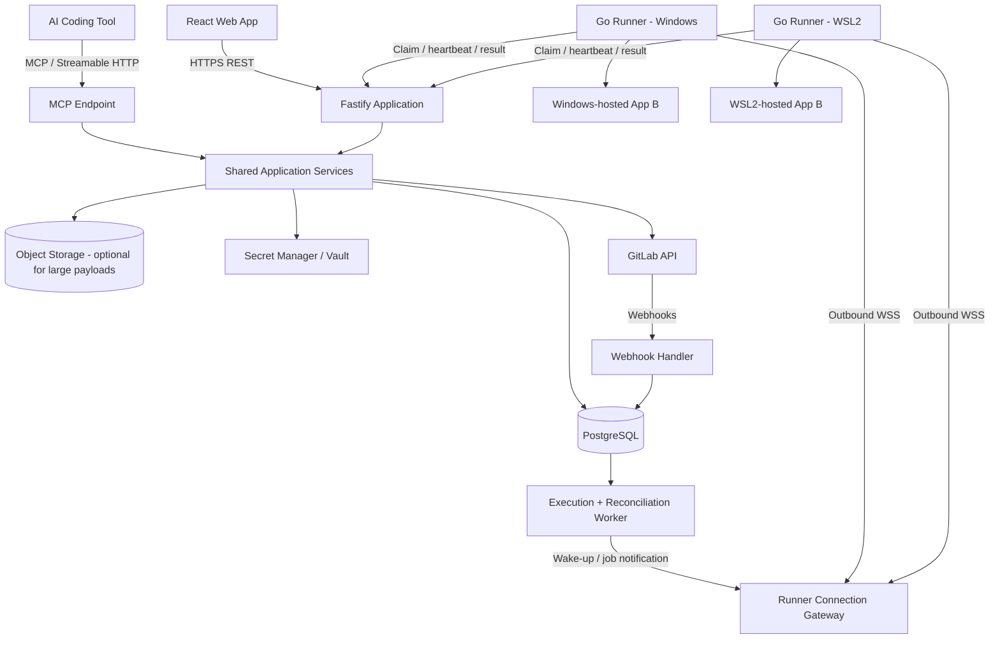
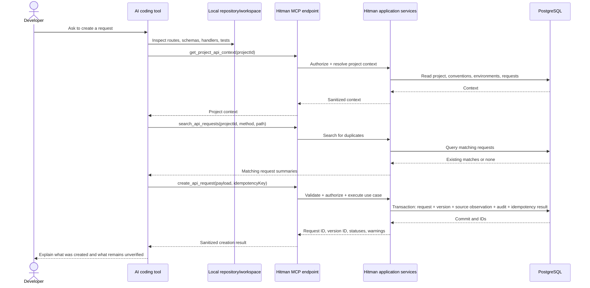
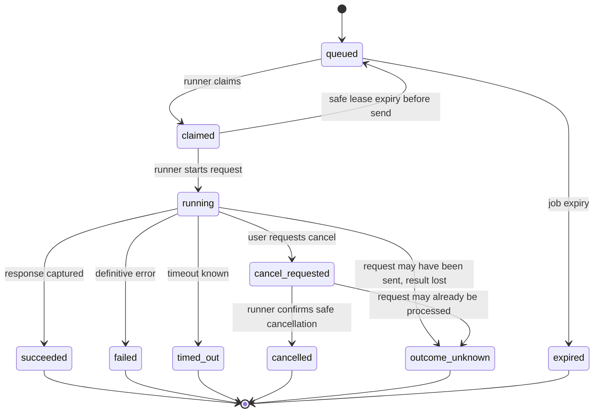
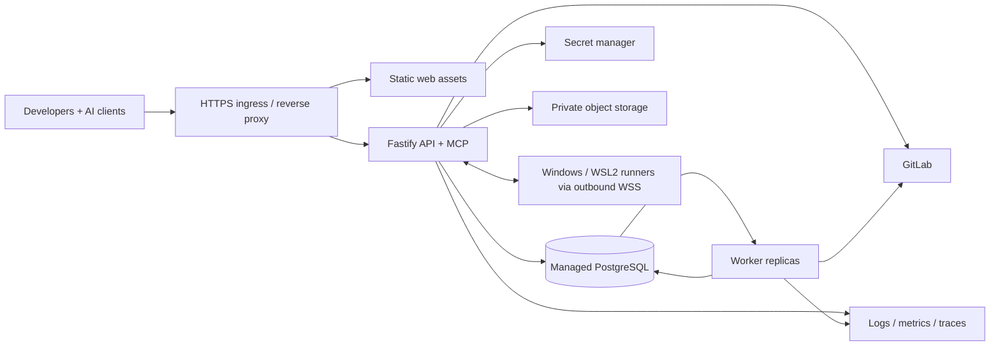

# Hitman — Product Requirements Document (PRD)

**Document status:** Proposed baseline for implementation  
**Product:** Hitman — Internal API Hub  
**Audience:** Product, backend, frontend, platform, security, and developer-experience teams  
**Last reviewed:** 2026-10-27  
**Primary deployment model:** Hosted web application + remote MCP endpoint + persistent local runners for Windows and WSL2

---

## 1. Executive summary

Hitman is an internal, company-wide API catalog and execution hub. It combines a Postman-like web application with an MCP server so developers and AI coding agents can discover, create, edit, execute, and track API requests across company projects.

A developer creates or selects a project in Hitman, connects its source repository and API contract where available, configures environments, and connects an AI coding tool to Hitman's MCP endpoint. When an AI agent works on a feature—even before the code is committed—it can inspect the project source and create a provisional request in Hitman. The developer can execute that request against a local application using a Go runner installed on Windows or inside WSL2. The runner maintains its own authenticated outbound connection to Hitman and continues running after the AI coding tool closes.

After the code is committed, included in a merge request, merged, or deployed, Hitman reconciles the request's source and deployment metadata with GitLab and deployment evidence. It must never infer that a feature is deployed simply because a merge request was merged.

Hitman is intended to become the shared source of truth for **saved API request definitions, request history, source provenance, available execution targets, and evidence of execution**. It is not intended to replace Git, the application's source code, GitLab, the deployment platform, or a full test automation framework.

### 1.1 Decisions in this PRD

- Use React + TypeScript for the web interface.
- Use Node.js LTS + TypeScript + Fastify for the central backend.
- Use the official MCP TypeScript SDK v2 and explicitly test the current MCP protocol revision (2026-07-28) plus any older client revisions that Hitman chooses to support.
- Use PostgreSQL + Drizzle ORM for application data and durable job state.
- Use Go for the local runner, with separate installations for Windows and WSL2.
- Use OpenAPI as the preferred API contract format, while allowing provisional requests when a formal contract is missing.
- Use remote MCP over Streamable HTTP for compatible clients; provide client-specific setup instructions and an optional stdio adapter only where required. Do not depend on MCP protocol sessions to store business/job state; store that state in Hitman and return stable job IDs.
- Use an authenticated outbound WebSocket from each runner, with durable jobs in PostgreSQL and an authenticated job-claim/result API as the source of truth.
- Start as a modular monolith. Keep the HTTP API, MCP endpoint, and worker logically separated, but do not start with microservices.
- Use GitLab webhooks for timely updates plus periodic reconciliation for reliability.
- Treat Windows and WSL2 runners as independent execution devices, even when owned by the same person.
- Treat request lifecycle, source state, deployment state, and execution state as separate dimensions.
- Do not permit arbitrary shell execution through the runner.

---

## 2. Problem statement

Company API definitions and example requests are often distributed across repositories, documentation, personal Postman collections, chat threads, and developer notes. This creates several problems:

1. Developers and AI coding agents cannot reliably discover the best existing request example for an endpoint.
2. Requests for new or in-progress features need to be created before their code is committed or merged.
3. A cloud-hosted application cannot directly reach `localhost` on a developer's computer.
4. Teams lack a common place to inspect the request, target environment, execution result, and source-code provenance together.
5. A merge request or merge event does not prove that a service has been deployed or verified in a particular environment.
6. A local execution agent introduces security risks if it can send unrestricted requests to a developer's machine or network.

Hitman solves these by centralizing API definitions and metadata, exposing them through a UI and MCP tools, and delegating local HTTP execution to a separately authenticated runner installed in the developer's environment.

---

## 3. Product goals

### 3.1 Goals

1. Provide a shared Postman-like API request management experience for company projects.
2. Allow developers and authorized AI agents to discover and manage API requests through the UI, REST API, and MCP.
3. Support requests created from uncommitted local code; branch, commit SHA, and merge request must be optional at creation time.
4. Run requests against developer-local services through an installed Go runner on Windows or WSL2.
5. Keep the runner alive independently of the AI coding tool and reconnect after interruptions.
6. Preserve request versions, execution history, source links, and audit events.
7. Connect projects with GitLab repositories and reconcile commit, merge-request, merge, and deployment status.
8. Represent request lifecycle, Git/source lifecycle, deployment state, and execution results independently.
9. Enforce project-level permissions, device authorization, environment policies, secret handling, and safe outbound-request rules.
10. Support gradual rollout from a small pilot to a company-wide installation without requiring a large microservice fleet.

### 3.2 Non-goals for the initial release

- Replacing GitLab, Git, IDEs, or AI coding tools.
- Running arbitrary scripts, shell commands, or user-provided code on a developer machine.
- Automatically inspecting every repository continuously without explicit project/repository configuration.
- Guaranteeing automatic route-to-source correlation when no specification, route metadata, or source link exists.
- Automatically deploying applications.
- Treating a merged merge request as deployment proof.
- Replacing a full load-testing, mocking, contract-testing, or CI test automation platform.
- Supporting every HTTP client feature from Postman in the first release.
- Building a custom desktop application as a prerequisite. A desktop shell may be considered later; the initial runner is a standalone background agent.
- Storing all large response bodies or binary uploads indefinitely in PostgreSQL.

---

## 4. Personas and access model

### 4.1 Developer

Creates and edits requests, connects projects to GitLab, configures environments, installs the local runner, executes requests, and reviews execution history.

### 4.2 AI coding agent

Connects to Hitman through MCP using the developer's authorized identity. It can discover project context, create or update requests, and request executions only within the permissions granted to that identity. It is not trusted to self-assert GitLab or deployment status.

### 4.3 Project maintainer

Manages project settings, repository mappings, environments, access policies, specification synchronization, and permitted execution targets.

### 4.4 Organization administrator

Manages organization membership, SSO/identity configuration, global policies, approved runner releases, audit access, and device revocation.

### 4.5 Platform/operations administrator

Maintains Hitman infrastructure, secrets, backups, monitoring, releases, and GitLab integration credentials.

### 4.6 Authorization principle

Every action is checked server-side against the authenticated user or service identity, organization, project membership, environment policy, and device authorization. Knowing a project ID, request ID, job ID, or device ID does not grant access.

---

## 5. Product terminology and state dimensions

These concepts must remain distinct throughout the data model and UI.

| Concept                     | Meaning                                                                                         | Example values                                                                                                                    |
| --------------------------- | ----------------------------------------------------------------------------------------------- | --------------------------------------------------------------------------------------------------------------------------------- |
| Request lifecycle           | Whether a saved request is being drafted or maintained                                          | `draft`, `ready`, `archived`                                                                                                      |
| Source-link state           | Whether Hitman has an explicit, usable source association                                       | `unlinked`, `linked`, `reconciliation_pending`, `sync_failed`                                                                     |
| Authoritative source status | Source lifecycle verified from GitLab or another approved source of truth                       | `unknown`, `committed`, `in_review`, `merged`, `closed`                                                                           |
| Source observation          | What the AI agent or developer reports about the local workspace; never authoritative by itself | `local_uncommitted`, `local_branch`, `agent_inferred`, with verification `unverified`, `verified`, or `rejected`                  |
| Deployment status           | Deployment evidence for a particular environment/release                                        | `unknown`, `not_deployed`, `deploying`, `deployed`, `failed`, `verified`                                                          |
| Execution status            | Outcome of a specific execution job                                                             | `queued`, `claimed`, `running`, `succeeded`, `failed`, `timed_out`, `cancel_requested`, `cancelled`, `outcome_unknown`, `expired` |
| Device connection status    | Current/recent runner connectivity                                                              | Derived as `online`, `offline`, `revoked`, `needs_update`                                                                         |
| UI badge                    | Human-friendly view derived from the dimensions above and policy                                | `DEV ONLY`, `DRAFT`, `IN REVIEW`, `INTEGRATED`, `DEPLOYED`, `STALE`                                                               |

A source observation such as `local_uncommitted` records what a caller reports; it does not mean GitLab has verified the source state. The UI must display the observation and its verification status separately from the source-link state and authoritative source status. `INTEGRATED`, `DEPLOYED`, and `STALE` are derived display states, not authoritative single database statuses. A merge is not proof of deployment. Deployment is not proof that a particular request was verified.

---

## 6. System architecture

### 6.1 Logical architecture



### 6.2 Deployment shape

The first release is a modular monolith with independently runnable entrypoints:

- `web`: built React static assets served by a CDN or web server.
- `api`: Fastify REST API plus the hosted MCP endpoint. MCP is its own module and route, even if deployed in the same Node.js process initially.
- `worker`: background processing for execution job scheduling, webhook processing, GitLab reconciliation, cleanup, and periodic tasks.
- `runner`: Go executable installed on Windows and inside WSL2; not deployed in the cloud.
- `postgres`: managed or self-hosted PostgreSQL.
- `object storage`: optional initially, recommended for large/binary request and response bodies.
- `secret manager`: use the company's existing secret-management facility if available; do not place long-lived plaintext credentials in application tables.

The runner initiates the network connection to Hitman. Hitman does not open an inbound listener on the developer's machine. This works across normal NAT/firewall setups when outbound HTTPS/WSS is permitted, but cannot execute while the machine, runner, or network is unavailable.

### 6.3 Internal code boundaries

Use domain/application modules rather than duplicating business logic between REST and MCP:

- `identity-access`
- `organizations-teams`
- `projects`
- `repositories-gitlab`
- `api-specifications`
- `collections-folders`
- `api-requests`
- `environments-secrets`
- `devices-runner-enrollment`
- `execution-jobs`
- `execution-results`
- `deployment-reconciliation`
- `audit-observability`

REST handlers and MCP tool handlers validate their transport-specific input and call the same application services. They must not have separate implementations of request creation, permission checks, job scheduling, or lifecycle rules.

---

## 7. Technology stack

### 7.1 Application stack

| Area                    | Choice                                                            | Notes                                                                                                  |
| ----------------------- | ----------------------------------------------------------------- | ------------------------------------------------------------------------------------------------------ |
| Frontend                | React + TypeScript + Vite                                         | Single-page web application                                                                            |
| Server-state management | TanStack Query                                                    | API fetching, caching, invalidation                                                                    |
| UI state                | React state first; Zustand only where shared UI state benefits    | Avoid unnecessary global state                                                                         |
| UI/style                | Tailwind CSS + shadcn/ui or equivalent approved component library | Accessible, consistent UI                                                                              |
| Request/response editor | CodeMirror 6                                                      | JSON/text editing and syntax highlighting; consider Monaco only if advanced IDE-like editing is needed |
| Backend runtime         | Node.js LTS + TypeScript                                          | Pin a currently supported LTS release in the repository; as of this review, Node.js 24 is an LTS line  |
| Backend framework       | Fastify                                                           | REST endpoints, validation, plugins, shared application services                                       |
| MCP                     | Official MCP TypeScript SDK v2                                    | Use the supported Fastify adapter where it meets requirements; pin and test SDK/client compatibility   |
| Database                | PostgreSQL                                                        | Relational data, transactions, JSONB for flexible data                                                 |
| ORM                     | Drizzle ORM                                                       | SQL-forward schema and migrations; review migration SQL for complex constraints/indexes                |
| Local runner            | Go                                                                | One codebase; build signed executables for Windows and Linux/WSL2                                      |
| Runner transport        | WebSocket over TLS (WSS) plus authenticated HTTPS endpoints       | Socket is notification channel, not durable job store                                                  |
| API contract            | OpenAPI                                                           | Prefer a version supported by the selected parser/validator; keep original source documents versioned  |
| Git integration         | GitLab API + webhooks + scheduled reconciliation                  | Webhook events are hints; reconcile against authoritative GitLab state                                 |
| Durable jobs            | PostgreSQL-backed queue/job tables initially                      | Introduce Redis/BullMQ only if workload and operations justify it                                      |
| Object storage          | S3-compatible storage, optional                                   | Binary bodies and large payloads, with retention and access policies                                   |
| Observability           | OpenTelemetry-compatible traces/metrics + structured logs         | Never log raw secrets or full bodies by default                                                        |

### 7.2 Why PostgreSQL

The application has relational relationships between organizations, members, projects, collections, requests, devices, jobs, source links, and deployments. Request/response content is flexible, but that does not make the whole application's data model document-only. Use JSONB for parsed JSON and metadata where useful, and preserve raw bodies separately when exact replay matters. Do not store every HTTP body as JSONB.

### 7.3 OpenAPI compatibility policy

Keep source specifications as versioned raw documents. For the MVP, support the OpenAPI versions the selected tooling can parse and validate reliably (minimum target: 3.0.x and 3.1.x). Conduct a compatibility spike for OpenAPI 3.2.x before claiming complete support. The latest specification at the time of this PRD is 3.2.1, but support must be based on tested parser/validator behavior, not specification publication alone.

### 7.4 Monorepo recommendation

A monorepo is recommended for the web/backend/worker contracts, while the Go runner can live in the same repository under a separate directory or a separate repository if distribution permissions require it.

```text
hitman/
  apps/
    web/                 # React + TypeScript
    server/              # Fastify REST + MCP endpoint
    worker/              # execution scheduling and reconciliation
  packages/
    contracts/           # shared TypeScript schemas/types
    api-client/          # generated/typed client if useful
    config/              # lint, TS, formatting configuration
  runner-go/
    cmd/hitman-runner/
    internal/enrollment/
    internal/connection/
    internal/jobs/
    internal/executor/
    internal/policy/
    internal/securestore/
    internal/telemetry/
  database/
    migrations/
    seeds/
  docs/
    architecture/
    runbooks/
```

Keep the network protocol between backend and Go runner in a versioned language-neutral JSON schema or OpenAPI/AsyncAPI-style contract. Do not attempt to share TypeScript implementation code with Go.

---

## 8. End-to-end product workflows

This section is the authoritative end-to-end workflow, from initial setup to source and deployment reconciliation.

### 8.1 Organization and user setup

1. Organization administrator configures Hitman identity integration (prefer company SSO/OIDC where available).
2. User signs in to Hitman.
3. Hitman resolves the user's organization and membership.
4. Organization or project role determines available actions.
5. New users do not automatically gain access to every project. Access is granted through team/project membership.
6. All privileged changes produce audit events.

### 8.2 Create a project in Hitman

1. User selects **Create project**.
2. User enters project name, slug, description, owning team, and optional tags.
3. User optionally connects a GitLab repository during setup or later.
4. User optionally imports an OpenAPI document or URL; a project can be created without a formal API specification.
5. User creates initial logical environments: for example `local`, `development`, `staging`, and `production`. Only environments needed by the team need to be created.
6. User assigns project members and roles.
7. Hitman creates the project, records its audit event, and opens the project's API workspace.
8. The project onboarding checklist shows which integrations are configured and what remains optional.

A project must not be blocked from creation solely because no GitLab repository, OpenAPI document, or runner is connected.

### 8.3 Connect GitLab repository

1. Project maintainer selects **Connect repository**.
2. Hitman authorizes access using an approved GitLab OAuth/app integration or a securely stored project/group token reference. Use least-privilege access.
3. User selects the GitLab project/repository and default branch.
4. Hitman records repository identity and a stable external project ID, not only the mutable URL.
5. User chooses whether to import an existing OpenAPI file and where it lives in the repository (path may be configured later).
6. Hitman attempts an initial read of repository metadata and, when configured, imports the current API specification.
7. Hitman records the imported specification version and source commit SHA.
8. Hitman registers or guides an administrator through GitLab webhook setup for relevant push, merge request, pipeline, and deployment events, depending on permissions and available GitLab configuration.
9. Hitman displays integration status and last successful sync time.
10. A periodic reconciliation worker checks for missed events, webhook failures, or stale state.

If a webhook is not supported or cannot be configured, polling/reconciliation remains available with reduced freshness.

### 8.4 Configure environments

An environment is a logical concept such as `local`, `staging`, or `production`. An execution target is the concrete destination used for a specific run.

1. Project maintainer creates a logical environment and sets its policy classification.
2. For shared environments, maintainer configures a base URL and secret references.
3. For local environments, each device owner creates or approves a device-specific target mapping—for example Windows `http://127.0.0.1:3000` and WSL2 `http://127.0.0.1:8080`.
4. Hitman validates the URL format and policy configuration. The runner repeats security checks at execution time.
5. Secrets are stored in an approved secret manager or encrypted store; request definitions reference secrets rather than embedding secret values.
6. Production targets are disabled for AI-initiated execution by default and require explicit policy/approval to enable.

### 8.5 Connect an AI coding tool to Hitman MCP

1. Developer opens Hitman's **MCP setup** page.
2. Hitman shows setup instructions for supported clients (for example OpenCode, Claude Code, and other compatible MCP clients). The endpoint uses remote Streamable HTTP where supported.
3. Developer adds the Hitman MCP endpoint to the client and completes the supported authentication/authorization flow.
4. The client authenticates with Hitman. The server checks the user's membership and permissions for every tool call.
5. The developer may optionally configure a local stdio adapter if a particular client/environment requires it; it is not the main remote execution mechanism.
6. The MCP setup page offers **Install local runner** as a separate, explicitly approved step. A remote MCP connection must not silently install software on the device.
7. After runner installation/enrollment, Hitman lists the available Windows and/or WSL2 devices.

### 8.6 Install and enroll the runner (Windows and WSL2)

The same Go codebase produces platform-specific release artifacts. Windows and WSL2 installations are separate devices because they have different local network namespaces and execution contexts.

**Windows path**

1. Developer downloads or runs the approved signed installer/setup command from Hitman.
2. The installer verifies artifact integrity and version.
3. Developer authenticates in a browser or uses a short-lived, single-use enrollment code.
4. Runner generates or stores a device identity securely and exchanges the enrollment code for a device-scoped credential.
5. Hitman associates the device with the user and organization. The device is not automatically authorized for every project or environment.
6. Runner starts as a user-level background process at login (or an approved Windows service if deployment policy requires it).
7. Runner opens an outbound WSS connection to Hitman and sends a heartbeat.
8. Hitman shows the Windows runner as online when heartbeat and authentication succeed.

**WSL2 path**

1. Developer opens the intended WSL2 distribution.
2. Developer runs the signed/downloaded Linux setup command inside that distribution.
3. The same short-lived enrollment flow registers a distinct WSL2 device.
4. Runner is configured as a user-level `systemd` service where supported, or via an approved startup mechanism.
5. Runner connects outbound to Hitman and sends a heartbeat.
6. Hitman lists Windows and WSL2 as independent devices, even if owned by the same user.

**Security requirements**

- Enrollment codes are single-use, short-lived, and scoped to the intended user/org.
- Each device gets a separate revocable credential/key.
- Private device keys are not uploaded to Hitman; store credentials in the OS-supported secure store where practical.
- Setup does not require admin/root privileges unless a specific installation mode requires it.
- Runner exposes no inbound listening port.
- The runner does not execute arbitrary shell commands.
- Updates are signed, versioned, and can be rolled back.

### 8.7 AI agent discovers a project and creates a request before commit

Example: a developer is implementing `POST /api/v1/bas` in App B and the changes are uncommitted.

1. Developer asks their AI coding agent to create a Hitman request for the new endpoint.
2. AI agent uses `list_projects` or `get_project_api_context` to verify project identity, conventions, existing operations, environments, and permissions.
3. AI agent inspects the local repository source code using its existing coding-tool capabilities. Hitman's runner does not need repository access for this flow.
4. The AI extracts a provisional method/path, parameters, body shape, content type, expected response, and relevant source file/line hints where discoverable.
5. The agent searches Hitman for an existing matching request to avoid duplicates.
6. The agent calls `create_api_request` with project, collection/folder if known, method/path, request payload, source hints, and lifecycle `draft` or `ready` according to confidence and configured policy.
7. Branch name, commit SHA, and MR IID are optional. The record can be created with `source_status = local_uncommitted` or `unlinked` plus provenance metadata stating that the definition was inferred from local code and has not been verified against GitLab.
8. Hitman validates input, checks authorization, enforces idempotency, creates the request and immutable version, and returns identifiers and any warnings.
9. If the request is ambiguous or required information is missing, the agent must not invent details. It should create a draft with explicit unresolved fields or ask the developer for clarification. It must not claim that the endpoint has been tested.
10. The developer can review/edit the request in Hitman's UI or continue through MCP.

AI inference is not the source of truth for deployment or merge status. Hitman records the claim's provenance and later reconciliation evidence separately.

### 8.7.1 Detailed MCP request-creation flow (authoritative behavior)

This subsection specifies exactly what happens when a developer asks an AI coding agent to create a Hitman request from code that may still be uncommitted.

#### Example developer instruction

> Inspect the current App B workspace and create a Hitman request for the new `POST /api/v1/bas` endpoint. Mark it `DEV ONLY`. Do not commit or push anything. Do not run it yet.

The endpoint and body in this example are illustrative. The agent must derive the actual request details from source code, existing tests, API contracts, or explicit developer input; it must not invent required fields merely to fill a request.

#### Sequence diagram



**Important boundary:** the AI coding tool inspects the developer's local source using its own workspace/file-access capabilities. The hosted Hitman MCP endpoint does not automatically read the developer's filesystem, and the Go runner is not required for request creation. The runner is required only when a request must execute inside that developer environment.

#### Step A — Resolve project context

1. The agent calls `list_projects` if it has not identified the project unambiguously, then calls `get_project_api_context` for the chosen `project_id`.
2. Hitman returns only authorized context: project identity, collections, relevant API operations/specification summaries, naming conventions, available logical environments, existing requests, and applicable policies. It does not return secret values or dump the whole project by default.
3. The agent inspects local source and may check route registration, validation schema, handler, service, tests, and existing request examples. It should prefer source facts over guesses and include repository-relative source paths only; do not store a developer's absolute home-directory path.
4. The agent calls `search_api_requests` for the same project/method/path before creating anything.
5. If a matching request already exists, the agent should report it and ask whether to reuse/update it if the intent is not clear. It must not create a duplicate merely because the request came from a different prompt. If the developer explicitly asks for a new variant, explain and preserve the distinction (for example, different body example or use case).

#### Step B — Build the request payload

The agent constructs a payload based on available evidence. The method and path are required for an executable request. A body is optional if the endpoint does not require one or if the correct body is not yet known. The agent must not fabricate authentication, secrets, query parameters, headers, or response schemas.

Conceptual MCP input:

```json
{
  "projectId": "project_uuid",
  "collectionId": null,
  "folderId": null,
  "name": "Create BA",
  "description": "Provisional request inferred from the current local workspace.",
  "requestLifecycle": "draft",
  "executionScope": "development_only",
  "request": {
    "method": "POST",
    "path": "/api/v1/bas",
    "queryParams": [],
    "headers": [{ "key": "Content-Type", "value": "application/json", "enabled": true }],
    "authConfig": { "type": "none" },
    "body": {
      "kind": "json",
      "value": { "example": "Only include fields supported by source evidence" }
    }
  },
  "sourceObservation": {
    "kind": "local_repository",
    "state": "local_uncommitted",
    "verificationStatus": "unverified",
    "repositoryPath": "services/bas/routes/ba.route.ts",
    "branchName": null,
    "commitSha": null,
    "mergeRequestIid": null,
    "matchMethod": "agent_hint"
  },
  "idempotencyKey": "caller-generated-unique-key"
}
```

This is a conceptual schema example; implement and version the actual runtime input schema in the codebase. The body is illustrative and must be replaced with evidence-based content. `requestLifecycle` defaults to `draft` for an AI-inferred request unless an explicit project policy and strong evidence allow a different default. `executionScope=development_only` is set because the developer explicitly requested `DEV ONLY`; it is an enforced policy, not only a visual tag.

If the method or path cannot be identified reliably, the agent must ask the developer for clarification rather than create a misleading executable request. If method/path are known but optional body details are uncertain, it may create a `draft` with a clear description/warning and omit the unknown details.

#### Step C — Validate the MCP call

Before writing records, Hitman must:

1. Validate the input against a versioned runtime schema and enforce size limits.
2. Authenticate the MCP caller and authorize the caller for the organization/project and requested action.
3. Verify collection/folder IDs belong to the specified project if supplied.
4. Validate method, path, body kind, header/query representation, content type, and request options.
5. Reject plaintext secret values in fields intended to hold secret references; never echo secret values back.
6. Validate `executionScope` against allowed values and project policy. `development_only` must deny shared staging/production targets even if the user selects them later.
7. Treat source details provided by the AI as an **unverified observation**, not as authoritative GitLab state. The AI cannot set `merged`, `deployed`, or `verified`.
8. Check duplicate candidates and idempotency before creation. If the same idempotency key is repeated with the same normalized payload, return the original result. If the same key is reused with a materially different payload, reject it as an idempotency conflict.

#### Step D — Database writes and transaction

For a successful first-time creation, Hitman performs a single database transaction. The logical writes are:

1. **`api_requests` — one row:** stable request identity, project/collection/folder (if supplied), name/description, `request_lifecycle='draft'`, `execution_scope='development_only'` when requested, creator/editor, and timestamps. The new request has no existing history before this operation.
2. **`api_request_versions` — one row:** version `1` with the immutable method/path/query/header/auth/body/options snapshot, change summary, creator/time, and source observation as it was known at creation. Secret values are references, never plaintext.
3. **`api_request_source_observations` — zero or one row:** if source hints were supplied, record what the agent reports it observed, such as `local_uncommitted`, the request version, repository-relative file/line hints, `match_method='agent_hint'`, and `verification_status='unverified'`. This record captures provenance and is not a claim verified by Hitman.
4. **`api_request_source_links` — usually zero rows at creation:** create/link one only when there is an actual configured GitLab repository and a source link worth recording. Missing branch, commit SHA, and MR IID are valid. Do not manufacture a GitLab link merely because the agent reports local code.
5. **`audit_events` — one row:** record `api_request.created`, actor type/user, project/resource IDs, correlation ID, and safe metadata such as method/path/lifecycle. Do not store secret values or full sensitive payloads in the audit metadata.
6. **Idempotency record — one row:** persist the key, normalized payload hash, actor/scope, and resource/result reference so retrying the same MCP call does not create a second request. Use an `idempotency_records` table or an equivalent implementation with a database uniqueness constraint.
7. **Outbox/event record — if the implementation uses a transactional outbox:** persist `api_request.created` in the same transaction when downstream notifications or asynchronous work depend on it. Do not publish an event before the transaction commits.

The `api_request_versions` row is immutable. Later source-state changes must update current source-link/reconciliation data or create a new observation; they must not rewrite what was known when version 1 was created. If any required write fails, roll back the entire transaction so the UI never sees a request without its first version.

A collection or folder is **not** created implicitly unless a separate product rule explicitly says so. When both IDs are null, the request appears in the project's uncategorized/unsorted view. Creating a request also does not create an execution job or execution result.

#### Step E — Exact initial state after creation

Assuming the developer asked for `DEV ONLY`, the expected state is:

| Resource/dimension            | State immediately after create                                                    | Why                                                                                           |
| ----------------------------- | --------------------------------------------------------------------------------- | --------------------------------------------------------------------------------------------- |
| Request record                | Created with stable `request_id`                                                  | The request is now saved in Hitman                                                            |
| Request version               | Version `1`, current version                                                      | Immutable snapshot of the submitted method/path/etc.                                          |
| Request lifecycle             | `draft`                                                                           | AI-inferred request awaiting developer review by default                                      |
| Execution scope               | `development_only`                                                                | Enforced constraint permitting only approved local/development targets                        |
| Source observation            | `local_uncommitted` as **agent-reported, unverified**, if supplied                | Records the origin claimed by the coding agent without treating it as authoritative Git state |
| Verified GitLab source status | `unlinked`/`unknown` until linked and reconciled                                  | No commit/MR is required to create the request                                                |
| Deployment state              | `unknown` / no deployment evidence record                                         | Creation cannot prove deployment                                                              |
| Execution state               | No job yet (`not_started` in the UI)                                              | Creating a definition does not mean it was executed                                           |
| Execution result              | None                                                                              | No HTTP request has run                                                                       |
| Audit trail                   | `api_request.created` recorded                                                    | Provides traceability                                                                         |
| UI badge                      | `DEV ONLY` plus `DRAFT`; optionally “Source: local changes reported (unverified)” | Derived from execution scope and provenance confidence, not from a fictional GitLab state     |

If `executionScope` is not provided, Hitman uses the project default and records that choice. It must not infer `DEV ONLY` solely from the fact the code is uncommitted. If no source observation is supplied, the source display is `unlinked` or `unknown`, not `local_uncommitted`.

#### Step F — Tool result returned to the agent

The MCP tool returns a concise response similar to:

```json
{
  "requestId": "request_uuid",
  "requestVersionId": "request_version_uuid",
  "versionNumber": 1,
  "requestLifecycle": "draft",
  "executionScope": "development_only",
  "source": {
    "reportedState": "local_uncommitted",
    "verificationStatus": "unverified",
    "gitlabLinkCreated": false
  },
  "execution": {
    "status": "not_started",
    "jobId": null
  },
  "warnings": ["Source details were reported by the AI agent and have not been verified by GitLab."]
}
```

The MCP tool must clearly distinguish **request created** from **request tested**. The agent should tell the developer the request ID, version, lifecycle, target restrictions, any missing information, and whether it has actually been executed.

#### Step G — What happens next (not part of request creation)

- If the developer chooses to run it, the agent/UI calls `start_execution`. Only then is an `execution_jobs` row created and moves through `queued`, `claimed`, `running`, and a terminal outcome. A runner must be online and authorized for the chosen target.
- If the request is edited, Hitman creates version `2` (or the next number), updates `api_requests.current_version_id`, and keeps version `1` immutable.
- When code is committed or an MR is opened, source metadata can be attached and later verified through GitLab reconciliation. Missing commit/MR fields at creation are not errors.
- When merged, the source state may become `merged` only from authoritative GitLab state; the request lifecycle does not automatically become `ready` unless policy/user action says so.
- When deployed, deployment evidence is recorded per environment. Only a matching deployment source/release can drive the deployment badge.
- When execution passes the configured verification rule, Hitman can mark the relevant verification evidence as verified. A created request by itself is never `INTEGRATED`, `DEPLOYED`, or `VERIFIED`.

### 8.7.2 Request creation: compact lifecycle and side effects

This table is the implementation checklist for the workflow above. It distinguishes read-only MCP calls from the transaction that creates a request and from later operations that create jobs or change source/deployment state.

| Phase / operation           | MCP call or trigger                                                                                          | Database effects                                                                                                                                                                                                                                                                          | State after the operation                                                                                                                       |
| --------------------------- | ------------------------------------------------------------------------------------------------------------ | ----------------------------------------------------------------------------------------------------------------------------------------------------------------------------------------------------------------------------------------------------------------------------------------- | ----------------------------------------------------------------------------------------------------------------------------------------------- |
| Identify project            | `list_projects`, then `get_project_api_context`                                                              | Read-only queries                                                                                                                                                                                                                                                                         | No request or job is created; only authorized, sanitized context is returned                                                                    |
| Inspect existing requests   | `search_api_requests`                                                                                        | Read-only query                                                                                                                                                                                                                                                                           | No state change; duplicate candidates are returned to the agent                                                                                 |
| Create request              | `create_api_request`                                                                                         | One transaction creates `api_requests` and `api_request_versions`; optionally creates `api_request_source_observations` and a source link; creates `audit_events` and an `idempotency_records` entry; optionally writes a transactional outbox event when asynchronous consumers need one | Request is `draft` by default; version `1` is current; `execution_scope` reflects the requested/project policy; no execution job/result exists  |
| Review/approve request      | UI action or `update_api_request`                                                                            | Update request lifecycle and audit record; create a new request version only if executable definition content changes                                                                                                                                                                     | Lifecycle can move from `draft` to `ready`; this does not imply execution or source verification                                                |
| Edit request                | UI or `update_api_request`                                                                                   | Insert next immutable `api_request_versions` row; update `api_requests.current_version_id`; write audit event                                                                                                                                                                             | New version is current; old versions remain unchanged                                                                                           |
| Execute request             | UI or `start_execution`                                                                                      | Insert `execution_jobs`; create an `execution_attempts` row when claimed/attempted; later insert `execution_results`                                                                                                                                                                      | Execution transitions through `queued`, `claimed`, `running`, and a terminal outcome; the saved request lifecycle does not change automatically |
| Commit / open merge request | GitLab webhook plus reconciliation, or a user/agent adds source hints that remain unverified until confirmed | Store webhook delivery; update/insert verified source-link state and reconciliation evidence after GitLab is queried                                                                                                                                                                      | Authoritative source status may become `committed` or `in_review`; request lifecycle remains independent                                        |
| Merge                       | GitLab webhook plus reconciliation                                                                           | Update source link/status and audit/reconciliation history                                                                                                                                                                                                                                | Authoritative source status becomes `merged`; deployment remains unknown until deployment evidence exists                                       |
| Deploy                      | Approved deployment integration/event                                                                        | Insert or update `deployments` evidence for a specific environment and commit/release                                                                                                                                                                                                     | Deployment status changes only for the evidenced environment/release; merge alone does not change it                                            |
| Verify behavior             | A successful execution/test that meets the configured verification rule                                      | Store execution evidence and any verification record supported by the schema                                                                                                                                                                                                              | Mark as verified only for the matching request version, target, and rule; request creation alone can never verify it                            |

#### Request creation invariants

- `create_api_request` creates a saved request definition, not an HTTP execution. It must not insert `execution_jobs`, `execution_attempts`, or `execution_results`.
- A new request gets a stable `request_id` and version `1`. The request's current-version pointer is set inside the same transaction after the version row is inserted.
- If no collection/folder is supplied, use the project's uncategorized view; do not create a collection or folder implicitly.
- A `DEV ONLY` request stores `execution_scope='development_only'`. The backend and runner enforce that policy during execution; a badge alone is insufficient.
- `requestLifecycle='draft'` is the default for AI-inferred requests. A source observation may say `local_uncommitted`, but the source link remains `unlinked` until an explicit link is established, and source verification remains `unverified` until checked against an appropriate authority.
- If the database transaction fails, none of its writes may remain. If the client times out after commit, retrying the same idempotency key and payload returns the same request/version IDs rather than creating a duplicate. Reusing the key with a different normalized payload is an idempotency conflict.
- A source merge changes source status only. It does not automatically mark a request `ready`, create an execution result, or mark a deployment `deployed`/`verified`.

### 8.8 Execute the request on a local device

1. Developer or authorized AI agent chooses `Run` and selects a specific execution target: `Windows runner` or `WSL2 runner` (or another approved target).
2. Hitman verifies user permission, project membership, request lifecycle, target authorization, environment policy, and whether approval is required.
3. Hitman resolves the selected environment target and creates a durable `execution_jobs` row with an immutable snapshot/reference to the request version.
4. Worker commits the job as `queued`, records an audit event, and notifies the selected runner over the active WSS connection. If the device is offline, the job remains queued or is rejected according to the user's queue/offline policy.
5. Runner claims the job via an authenticated HTTPS endpoint. Claiming is atomic; only one active lease is issued for that attempt.
6. Hitman sends the approved request snapshot, target ID, execution policy, allowed headers, timeouts, size limits, and short-lived secret material or references as required. Secrets must only be provided to an authorized runner and never returned in MCP output.
7. Runner resolves the local base URL (the stored request should use a path, not a developer-specific hard-coded host), validates target and redirect policy, and executes the HTTP request from its own network context.
8. Runner collects the status code, duration, response headers after filtering, and a bounded response body.
9. Runner posts the result and acknowledges the job. If the request might have been processed but the response was lost, the result can be `outcome_unknown`; Hitman must not blindly re-run non-idempotent requests.
10. Hitman persists result metadata/body or object-storage reference, updates job state, emits an audit event, and notifies the UI/MCP caller.
11. UI displays method, path, target device, environment, request version, HTTP status, duration, selected headers, response body, errors, and execution time.
12. The AI agent reads the sanitized result and may iterate on the request or report to the developer.

### 8.9 Runner goes offline during execution

1. Heartbeat timeout marks the device as offline/unknown; do not instantly assume the machine is shut down.
2. If no job was claimed, queued jobs remain eligible until their expiry policy.
3. If a job was claimed but not started, its lease expires and it can be safely re-queued if no request was sent.
4. If a request may have been sent but the result did not arrive, mark the attempt `outcome_unknown` unless the runner can prove it did not send the request.
5. Show the user the exact uncertainty and require a deliberate retry for non-idempotent methods.
6. When the runner reconnects, it authenticates, resumes heartbeats, and queries eligible jobs; the server does not rely on missed WebSocket messages being replayed.

### 8.10 Commit, push, and merge request reconciliation

1. Developer commits and pushes the change in GitLab.
2. GitLab sends webhook event(s) for push/merge-request changes when configured.
3. Hitman verifies the webhook secret/signature according to GitLab's supported mechanism, deduplicates the delivery, stores the event, and acknowledges quickly.
4. A worker processes the event asynchronously and queries GitLab's API for authoritative current repository/MR state when necessary.
5. If the request has an explicit source link or the OpenAPI file changed in a known path, Hitman updates source metadata and imports a new specification version if configured.
6. If the request was initially inferred from local code, Hitman may suggest a match based on method/path and repository evidence. Ambiguous matches are flagged for confirmation; they must not be silently merged into the wrong request.
7. The source state may transition to `committed`, `in_review`, `merged`, or `closed` according to authoritative GitLab state.
8. Hitman preserves the previous request versions and records reconciliation evidence and timestamps.
9. A scheduled reconciliation catches missed, delayed, duplicated, or failed webhook processing.

### 8.11 Deployment lifecycle

1. Hitman receives a GitLab deployment webhook or queries an approved deployment/CI source.
2. It records the environment, deployment identifier, commit SHA/release, status, timestamps, and evidence reference.
3. Deployment state is tracked per environment and commit/release; a staging deployment says nothing about production deployment.
4. An API request is marked `DEPLOYED` only when Hitman has appropriate deployment evidence matching the relevant source revision and target environment according to project policy.
5. A request is marked `VERIFIED` only after an execution or test result meeting the configured verification rule, not just a successful deployment event.
6. If no authoritative deployment source is configured, status remains `unknown`; Hitman must not infer deployment from a merge.

### 8.12 Archive, stale detection, and cleanup

- A user or maintainer may archive a request without deleting its history.
- A stale badge can be derived when a linked OpenAPI operation disappears, the source path changes, a newer contract differs materially, or the request has not been validated within a configured period.
- Stale detection creates an explanation and suggested review action; it should not silently delete or overwrite saved requests.
- Device revocation immediately prevents future authentication/job claims. In-flight work is cancelled where safe and audited.
- Retention jobs apply configured policies to execution bodies, logs, and old artifacts while preserving essential audit records.

---

## 9. Functional requirements

Priority levels: **P0** required for initial usable release; **P1** important follow-up; **P2** later enhancement.

### 9.1 Projects and membership

- **FR-001 (P0):** A user can create, view, edit, and archive a project.
- **FR-002 (P0):** Each project has a stable ID, unique organization-scoped slug, name, description, owner/team, and timestamps.
- **FR-003 (P0):** A project can exist without GitLab or OpenAPI integration.
- **FR-004 (P0):** Project administrators can assign users/team memberships and roles.
- **FR-005 (P0):** All project and API data access is scoped by authorization.

### 9.2 API catalog and request editor

- **FR-010 (P0):** Users can create and organize collections/folders.
- **FR-011 (P0):** Users can create, edit, clone, search, archive, and version API requests.
- **FR-012 (P0):** A request supports method, path, ordered query parameters, ordered headers, body representation, authentication reference, content type, and description.
- **FR-013 (P0):** Requests use environment-specific base URLs; request paths should not embed machine-specific local hostnames by default.
- **FR-014 (P0):** A request can exist before code commit; branch, commit, and MR fields are optional.
- **FR-015 (P0):** Request create/update operations support idempotency to avoid duplicate records from repeated MCP calls.
- **FR-016 (P0):** Hitman maintains immutable request versions and an identifiable current version.
- **FR-017 (P1):** Users can compare versions and restore an earlier version by creating a new version.
- **FR-018 (P0):** Body representation supports JSON, text/raw, form URL-encoded, multipart metadata, and binary/object-storage references according to content size and type.
- **FR-019 (P0):** Duplicate header/query keys and disabled entries are preserved when represented by the editor.

### 9.3 OpenAPI support

- **FR-020 (P0):** A project maintainer can import an OpenAPI document from a file or configured repository path.
- **FR-021 (P0):** Hitman stores the original document and source/version metadata.
- **FR-022 (P0):** Hitman parses API operations into searchable operation records where supported.
- **FR-023 (P0):** Import validation reports actionable errors and warnings without destroying the last valid specification.
- **FR-024 (P1):** Hitman compares specification versions and flags added, changed, and removed operations.
- **FR-025 (P1):** Requests can link to a formal OpenAPI operation while remaining separately editable examples.

### 9.4 Environments and secrets

- **FR-030 (P0):** Project maintainers can create logical environments and set classification/policy.
- **FR-031 (P0):** The same saved request can run against different targets without editing its path/body.
- **FR-032 (P0):** Each Windows/WSL2 runner can have a device-specific local target mapping.
- **FR-033 (P0):** Secrets are referenced and masked, not embedded in returned MCP contexts or normal logs.
- **FR-034 (P0):** Production execution is denied by default for AI-initiated execution unless explicitly enabled with policy and approval.

### 9.5 MCP

- **FR-040 (P0):** Hitman exposes authenticated MCP tools for project discovery, API context/search, request creation/editing, target listing, execution initiation, and result retrieval.
- **FR-041 (P0):** MCP tool calls use the same application services and access rules as REST.
- **FR-042 (P0):** MCP results return stable IDs, validation issues, and sanitized data; they do not expose credentials.
- **FR-043 (P0):** Long-running requests return a job ID with bounded waiting/polling options instead of blocking indefinitely.
- **FR-044 (P0):** A failed or ambiguous request inference is represented honestly; the agent must not claim tests passed without execution evidence.
- **FR-045 (P1):** Client setup documentation includes tested configurations for the company's supported coding tools.

### 9.6 Local runner and device management

- **FR-050 (P0):** Hitman can register multiple runners per user, including Windows and WSL2 instances.
- **FR-051 (P0):** Each runner has separate credentials, version, platform, last-seen timestamp, status, and revocation state.
- **FR-052 (P0):** Runner connects outbound to Hitman and exposes no inbound listener.
- **FR-053 (P0):** Runner uses heartbeat, reconnect/backoff, job claim, lease, acknowledgment, and result-reporting flows.
- **FR-054 (P0):** Runner executes only HTTP requests defined by approved job payloads; no arbitrary shell command execution.
- **FR-055 (P0):** Runner validates allowed targets, ports, redirect destinations, payload size, timeouts, and configured policies.
- **FR-056 (P0):** An administrator or device owner can revoke a runner.
- **FR-057 (P1):** Hitman supports signed update checks, staged rollout, and rollback for runner releases.
- **FR-058 (P1):** App A provides clear online/offline, last heartbeat, version, and diagnostics information.

### 9.7 Execution and history

- **FR-060 (P0):** Each execution targets a specific request version, environment target, and device or cloud target.
- **FR-061 (P0):** Job and result state is durable across server restarts.
- **FR-062 (P0):** Execution history stores status code, timing, selected headers, sanitized response body/reference, request-version reference, target, and actor.
- **FR-063 (P0):** Results have configurable size limits and retention.
- **FR-064 (P0):** Hitman differentiates failed, timed-out, cancelled, expired, and outcome-unknown executions.
- **FR-065 (P0):** Retry policies are conservative for non-idempotent methods and never blindly replay an ambiguous `POST`.
- **FR-066 (P1):** Users can export selected request collections in a documented format.

### 9.8 GitLab, source provenance, deployment

- **FR-070 (P0):** Project maintainers can link a GitLab repository.
- **FR-071 (P0):** Hitman handles relevant webhook deliveries idempotently and records processing status.
- **FR-072 (P0):** Scheduled reconciliation detects missed events and stale integration state.
- **FR-073 (P0):** Request source fields such as branch, commit SHA, MR IID, source file, and line hints are optional and can be populated later.
- **FR-074 (P0):** Hitman does not silently match ambiguous source changes to requests.
- **FR-075 (P0):** Source/merge status and deployment status are separate.
- **FR-076 (P0):** Deployment status requires authoritative evidence from GitLab or an approved deployment integration.
- **FR-077 (P1):** Specification and source changes can flag linked requests as changed or stale.

### 9.9 Administration and auditing

- **FR-080 (P0):** Important actions produce audit events: project/configuration changes, request changes, device enrollment/revocation, execution, secret-policy changes, GitLab integration changes, and administrative actions.
- **FR-081 (P0):** Administrators can inspect runner status, recent jobs, webhook failures, and integration sync status.
- **FR-082 (P0):** Audit events capture actor, action, resource, timestamp, outcome, and correlation ID, without recording secrets or raw sensitive payloads.
- **FR-083 (P1):** Administrators can configure retention for execution data and response bodies.

---

## 10. MCP tool contract

Tool names and schemas are a versioned public interface for AI clients. Tool descriptions must explain the intended use, required authorization, side effects, and failure modes.

### 10.1 Initial tool set

| Tool                      | Input (conceptual)                                                                                                         | Result                                                                                                                                         |
| ------------------------- | -------------------------------------------------------------------------------------------------------------------------- | ---------------------------------------------------------------------------------------------------------------------------------------------- |
| `list_projects`           | query/filter/page                                                                                                          | Authorized project summaries                                                                                                                   |
| `get_project_api_context` | project ID, optional topic/path                                                                                            | Relevant project metadata, environments, API conventions, linked specs, matching operations/requests; secrets excluded                         |
| `search_api_requests`     | project ID, search text, method/path filters                                                                               | Matching request summaries and IDs                                                                                                             |
| `get_api_request`         | request ID/version optional                                                                                                | Request definition and source status, with credentials redacted                                                                                |
| `create_api_request`      | project ID, optional collection/folder, request definition, optional `executionScope`, source observation, idempotency key | Created request/version IDs, lifecycle, enforced execution scope, unverified source observation status, validation warnings; no job is created |
| `update_api_request`      | request ID, patch, reason/source metadata                                                                                  | New version ID and change summary                                                                                                              |
| `list_execution_targets`  | project ID, logical environment                                                                                            | Authorized online/offline target list; never returns credentials                                                                               |
| `start_execution`         | request ID/version, environment, device ID/target ID, approval context                                                     | Job ID and initial state                                                                                                                       |
| `get_execution_result`    | job ID                                                                                                                     | State and sanitized result, or running/unknown status                                                                                          |
| `cancel_execution`        | job ID                                                                                                                     | Cancellation request/status; explains if the request may already have been sent                                                                |

### 10.2 Tool behavior rules

- Every input is validated by a runtime schema and server-side authorization.
- Tools return stable IDs rather than relying on mutable names alone.
- `create_api_request` should accept a caller-generated idempotency key and optionally a source fingerprint to prevent duplicate drafts.
- For code that has not been committed, source fields may be absent. The tool must not require a branch/commit/MR.
- A tool cannot directly set `merged`, `deployed`, or `verified` based solely on AI-provided claims. It can attach source hints, which reconciliation later confirms.
- Tool context should be concise and relevant; do not return every project's entire specification by default.
- Any response body returned to the model must be size-limited and sanitized according to policy.
- Execution tool output should include whether the result is actual execution evidence or only a queued/running status.
- Transport errors must be distinguishable from application failures and HTTP response failures.

---

## 11. Runner/backend protocol

### 11.1 Protocol principles

- Version every message (`protocolVersion`).
- Use authenticated, encrypted outbound connections.
- The WebSocket is for notifications, heartbeat, and optional small control messages; the database-backed job record is authoritative.
- Use explicit claim/lease semantics so two runner connections cannot execute the same queued job concurrently.
- Use server-issued short-lived execution authorization/policy for each job.
- Bound all messages and result bodies by size.
- Include correlation IDs and attempt numbers.
- Make protocol schema compatibility explicit. An old runner should report an incompatible version and receive a safe error rather than misinterpreting a job.

### 11.2 Example control messages

```json
{
  "type": "runner.hello",
  "protocolVersion": 1,
  "deviceId": "device_uuid",
  "runnerVersion": "1.0.0",
  "platform": "windows-amd64",
  "capabilities": ["http-execution", "json-body", "text-body", "multipart-metadata"]
}
```

```json
{
  "type": "job.available",
  "jobId": "job_uuid",
  "expiresAt": "2026-10-27T05:00:00Z"
}
```

The runner then makes an authenticated HTTPS claim request rather than trusting a complete job solely from an unacknowledged socket message. The server returns the approved job snapshot and lease details.

```json
{
  "type": "runner.heartbeat",
  "deviceId": "device_uuid",
  "runnerVersion": "1.0.0",
  "status": "idle",
  "activeJobId": null
}
```

```json
{
  "type": "job.result",
  "jobId": "job_uuid",
  "attemptId": "attempt_uuid",
  "outcome": "succeeded",
  "httpStatus": 201,
  "durationMs": 143,
  "responseBodyRef": null,
  "responseTruncated": false
}
```

These are conceptual examples, not final wire schemas. Define and test formal schemas in the repository before implementation.

### 11.3 Job lifecycle



### 11.4 HTTP request execution rules

- Resolve the target's base URL on the runner or from an approved target mapping; do not let an MCP caller override it freely.
- Resolve the final destination and validate host/port/network policy immediately before connection.
- Validate every redirect; either disable redirects by default or revalidate each redirect target before following it.
- Apply connect, TLS handshake, response-header, and total timeouts.
- Bound request and response bytes and reject unsupported payload types with clear errors.
- Do not forward ambient machine credentials or OS proxy credentials unless explicitly configured.
- Redact secrets in headers and response fields using built-in sensitive-header rules plus project-configured patterns.
- Record what policy allowed the target, without logging secret values.
- For production or risky environments, require approval or deny by policy.
- Do not implement shell execution in the MVP.

---

## 12. Database design

The schema below is a logical starting design, not a substitute for reviewed migrations. Use UUID primary keys unless the repository uses another established convention. Use `timestamptz` for event times. Store mutable state in normalized columns; use JSONB for flexible metadata and structured request/response components where appropriate. Index for measured query patterns rather than adding every possible JSON index on day one.

### 12.1 Identity, teams, and projects

#### `organizations`

- `id UUID PK`
- `name TEXT NOT NULL`
- `slug TEXT NOT NULL UNIQUE`
- `identity_provider_key TEXT NULL`
- `settings JSONB NOT NULL DEFAULT '{}'`
- `created_at TIMESTAMPTZ NOT NULL`
- `updated_at TIMESTAMPTZ NOT NULL`

#### `users`

- `id UUID PK`
- `external_subject TEXT NOT NULL UNIQUE` — stable identity-provider subject
- `email TEXT NOT NULL`
- `display_name TEXT NOT NULL`
- `status TEXT NOT NULL` — active/disabled/pending
- `created_at`, `updated_at TIMESTAMPTZ`

#### `organization_memberships`

- `organization_id UUID FK`
- `user_id UUID FK`
- `role TEXT NOT NULL` — org_admin/member/read_only as policy defines
- `created_at TIMESTAMPTZ`
- Primary key: (`organization_id`, `user_id`)

#### `teams`

- `id UUID PK`
- `organization_id UUID FK NOT NULL`
- `name TEXT NOT NULL`
- `slug TEXT NOT NULL`
- `created_at`, `updated_at TIMESTAMPTZ`
- Unique: (`organization_id`, `slug`)

#### `team_memberships`

- `team_id UUID FK NOT NULL`
- `user_id UUID FK NOT NULL`
- `role TEXT NOT NULL`
- `created_at TIMESTAMPTZ`
- Primary key: (`team_id`, `user_id`)

#### `projects`

- `id UUID PK`
- `organization_id UUID FK NOT NULL`
- `owner_team_id UUID FK NULL`
- `name TEXT NOT NULL`
- `slug TEXT NOT NULL`
- `description TEXT NULL`
- `status TEXT NOT NULL` — active/archived
- `settings JSONB NOT NULL DEFAULT '{}'`
- `created_by UUID FK NOT NULL`
- `created_at`, `updated_at TIMESTAMPTZ NOT NULL`
- Unique: (`organization_id`, `slug`)

#### `project_memberships`

- `project_id UUID FK NOT NULL`
- `user_id UUID FK NOT NULL`
- `role TEXT NOT NULL` — project_admin/editor/executor/viewer
- `created_at TIMESTAMPTZ`
- Primary key: (`project_id`, `user_id`)

### 12.2 GitLab integration and API specifications

#### `gitlab_connections`

- `id UUID PK`
- `organization_id UUID FK NOT NULL`
- `gitlab_instance_url TEXT NOT NULL`
- `auth_mode TEXT NOT NULL`
- `credential_secret_ref TEXT NOT NULL` — reference to secret manager, not the token itself
- `status TEXT NOT NULL`
- `last_verified_at TIMESTAMPTZ NULL`
- `created_by UUID FK NOT NULL`
- `created_at`, `updated_at TIMESTAMPTZ`

#### `gitlab_repositories`

- `id UUID PK`
- `project_id UUID FK NOT NULL`
- `gitlab_connection_id UUID FK NOT NULL`
- `external_project_id TEXT NOT NULL`
- `namespace_path TEXT NULL`
- `repository_url TEXT NOT NULL`
- `default_branch TEXT NULL`
- `openapi_file_path TEXT NULL`
- `webhook_status TEXT NOT NULL`
- `last_reconciled_at TIMESTAMPTZ NULL`
- `created_at`, `updated_at TIMESTAMPTZ`
- Unique: (`gitlab_connection_id`, `external_project_id`)

#### `api_specifications`

- `id UUID PK`
- `project_id UUID FK NOT NULL`
- `gitlab_repository_id UUID FK NULL`
- `version_label TEXT NULL`
- `spec_version TEXT NULL` — OpenAPI version reported by document
- `source_kind TEXT NOT NULL` — upload/repository/url
- `source_ref TEXT NULL` — file path or approved source reference
- `source_commit_sha TEXT NULL`
- `document JSONB NOT NULL` — parsed/original structure if JSON/YAML normalized to JSON
- `raw_document_object_key TEXT NULL` — optional original YAML/JSON artifact
- `content_hash TEXT NOT NULL`
- `validation_status TEXT NOT NULL`
- `validation_report JSONB NOT NULL DEFAULT '{}'`
- `created_by UUID FK NOT NULL`
- `created_at TIMESTAMPTZ NOT NULL`
- Unique suggested: (`project_id`, `content_hash`)

#### `api_specification_versions`

Optional if `api_specifications` represents a stable logical document. Otherwise, version specifications by separate `api_specifications` rows. Choose one strategy consistently; do not add both models without a clear need.

#### `api_operations`

- `id UUID PK`
- `project_id UUID FK NOT NULL`
- `api_specification_id UUID FK NOT NULL`
- `operation_key TEXT NOT NULL` — stable operation ID or derived key
- `method TEXT NOT NULL`
- `path_template TEXT NOT NULL`
- `summary TEXT NULL`
- `tags JSONB NOT NULL DEFAULT '[]'`
- `operation_document JSONB NOT NULL`
- `content_hash TEXT NOT NULL`
- `created_at`, `updated_at TIMESTAMPTZ`
- Index: (`project_id`, `method`, `path_template`)
- Unique suggested: (`api_specification_id`, `operation_key`)

### 12.3 Collections and request definitions

#### `collections`

- `id UUID PK`
- `project_id UUID FK NOT NULL`
- `name TEXT NOT NULL`
- `description TEXT NULL`
- `sort_order INTEGER NOT NULL DEFAULT 0`
- `created_by UUID FK NOT NULL`
- `created_at`, `updated_at TIMESTAMPTZ`

#### `collection_folders`

- `id UUID PK`
- `collection_id UUID FK NOT NULL`
- `parent_folder_id UUID FK NULL`
- `name TEXT NOT NULL`
- `sort_order INTEGER NOT NULL DEFAULT 0`
- `created_at`, `updated_at TIMESTAMPTZ`

#### `api_requests`

Stable identity and mutable catalog metadata for a request.

- `id UUID PK`
- `project_id UUID FK NOT NULL`
- `collection_id UUID FK NULL`
- `folder_id UUID FK NULL`
- `api_operation_id UUID FK NULL`
- `name TEXT NOT NULL`
- `description TEXT NULL`
- `request_lifecycle TEXT NOT NULL` — draft/ready/archived
- `execution_scope TEXT NOT NULL DEFAULT 'environment_policy'` — `development_only` / `environment_policy`; enforced during execution, not just a UI badge
- `current_version_id UUID NULL` — FK to `api_request_versions` after creation flow is handled
- `created_by UUID FK NOT NULL`
- `updated_by UUID FK NOT NULL`
- `created_at`, `updated_at TIMESTAMPTZ NOT NULL`
- `archived_at TIMESTAMPTZ NULL`
- Indexes: (`project_id`, `request_lifecycle`), `api_operation_id`

#### `api_request_versions`

Immutable snapshot of executable request settings. Every meaningful edit creates a new version.

- `id UUID PK`
- `api_request_id UUID FK NOT NULL`
- `version_number INTEGER NOT NULL`
- `method TEXT NOT NULL`
- `path TEXT NOT NULL`
- `query_params JSONB NOT NULL DEFAULT '[]'` — ordered entries, allowing duplicate keys and disabled entries
- `headers JSONB NOT NULL DEFAULT '[]'` — ordered entries; secret values must be references/masked, not plaintext in ordinary request snapshots
- `auth_config JSONB NOT NULL DEFAULT '{}'` — auth type/options; secret values represented by references
- `body_kind TEXT NOT NULL` — none/json/text/urlencoded/multipart/binary
- `body_json JSONB NULL`
- `body_text TEXT NULL`
- `body_object_key TEXT NULL`
- `body_content_type TEXT NULL`
- `body_encoding TEXT NULL`
- `request_options JSONB NOT NULL DEFAULT '{}'` — timeout, redirect policy, etc.; policy-critical values are also enforced server-side
- `response_assertions JSONB NOT NULL DEFAULT '[]'` — optional future feature
- `change_summary TEXT NULL`
- `source_observation_at_creation TEXT NOT NULL DEFAULT 'unknown'` — an immutable observation captured when this request version was created, not the current source status
- `source_metadata JSONB NOT NULL DEFAULT '{}'` — non-authoritative source hints; authoritative, current provenance should use source-link/reconciliation records
- `created_by UUID FK NOT NULL`
- `created_at TIMESTAMPTZ NOT NULL`
- Unique: (`api_request_id`, `version_number`)
- Indexes: (`api_request_id`, `created_at`)

Do not store full secret values in `headers`, `auth_config`, or MCP-visible snapshots. A migration review must also account for the circular reference between `api_requests.current_version_id` and `api_request_versions.id`; create the request first, insert the first version, then set the current-version reference in a transaction, or use an equivalent non-circular design.

#### `api_request_source_observations`

Captures source/provenance claims at the time they are observed. This table allows a request to be created from a local workspace even when the project has no GitLab repository link yet.

- `id UUID PK`
- `api_request_id UUID FK NOT NULL`
- `api_request_version_id UUID FK NULL`
- `source_kind TEXT NOT NULL` — `local_repository` / `gitlab` / `openapi` / `agent_inference` / `manual`
- `observed_state TEXT NOT NULL` — `local_uncommitted` / `committed` / `in_review` / `merged` / `closed` / `unknown`
- `verification_status TEXT NOT NULL` — `unverified` / `verified` / `rejected`
- `repository_id UUID FK NULL` — Hitman/GitLab repository record when known
- `repository_path TEXT NULL` — repository-relative path only; never absolute developer home path
- `branch_name TEXT NULL`
- `commit_sha TEXT NULL`
- `merge_request_iid TEXT NULL`
- `source_start_line INTEGER NULL`
- `source_end_line INTEGER NULL`
- `match_method TEXT NOT NULL` — `explicit` / `contract_match` / `suggested` / `agent_hint` / `manual`
- `confidence NUMERIC NULL` — informational only; not authoritative state
- `observed_by_user_id UUID FK NULL`
- `observed_by_device_id UUID FK NULL`
- `created_at TIMESTAMPTZ NOT NULL`
- Indexes: (`api_request_id`, `created_at`), (`repository_id`, `commit_sha`)

The observation is an immutable record of what a caller reported. A `local_uncommitted` observation supplied by an AI tool is unverified until a relevant workflow independently confirms it. A verification record must preserve the original observation and record who/what verified or rejected it.

#### `api_request_source_links`

Represents a request's explicit association with a configured GitLab repository/source lifecycle. This is different from an unverified source observation.

- `id UUID PK`
- `api_request_id UUID FK NOT NULL`
- `api_request_version_id UUID FK NULL`
- `gitlab_repository_id UUID FK NOT NULL`
- `branch_name TEXT NULL`
- `commit_sha TEXT NULL`
- `merge_request_iid TEXT NULL`
- `source_file_path TEXT NULL`
- `source_start_line INTEGER NULL`
- `source_end_line INTEGER NULL`
- `source_status TEXT NOT NULL`
- `match_method TEXT NOT NULL` — explicit/contract_match/suggested/agent_hint
- `confidence NUMERIC NULL` — only for suggestions; never treat it as authoritative state
- `last_verified_at TIMESTAMPTZ NULL`
- `created_by UUID FK NULL`
- `created_at`, `updated_at TIMESTAMPTZ`
- Index: (`gitlab_repository_id`, `commit_sha`), (`api_request_id`)

### 12.4 Environments and secrets

#### `environments`

- `id UUID PK`
- `project_id UUID FK NOT NULL`
- `name TEXT NOT NULL` — local/development/staging/production or team-defined value
- `classification TEXT NOT NULL` — local/development/staging/production/custom
- `execution_policy JSONB NOT NULL DEFAULT '{}'`
- `created_by UUID FK NOT NULL`
- `created_at`, `updated_at TIMESTAMPTZ`
- Unique: (`project_id`, `name`)

#### `environment_targets`

A target is a concrete URL/context, possibly bound to a local runner.

- `id UUID PK`
- `environment_id UUID FK NOT NULL`
- `device_id UUID FK NULL` — null for shared/cloud target; set for a device-local target
- `target_kind TEXT NOT NULL` — shared/cloud/device_local
- `display_name TEXT NOT NULL`
- `base_url TEXT NOT NULL`
- `allowed_hosts JSONB NOT NULL DEFAULT '[]'`
- `allowed_ports JSONB NOT NULL DEFAULT '[]'`
- `redirect_policy TEXT NOT NULL DEFAULT 'deny_unapproved'`
- `is_enabled BOOLEAN NOT NULL DEFAULT TRUE`
- `config JSONB NOT NULL DEFAULT '{}'` — no plaintext secret values
- `created_by UUID FK NOT NULL`
- `created_at`, `updated_at TIMESTAMPTZ`
- Index: (`environment_id`, `device_id`)

#### `environment_variables`

- `id UUID PK`
- `environment_target_id UUID FK NOT NULL`
- `key TEXT NOT NULL`
- `value_kind TEXT NOT NULL` — plain/secret_ref/device_secret_ref
- `plain_value TEXT NULL` — only for non-sensitive values
- `secret_ref TEXT NULL` — pointer to vault/secure store
- `is_sensitive BOOLEAN NOT NULL DEFAULT FALSE`
- `created_at`, `updated_at TIMESTAMPTZ`
- Unique: (`environment_target_id`, `key`)

Use a central secret manager where available. If secrets must reach a local runner to execute a request, deliver them only to that authorized runner at execution time, in memory where possible, and never persist them in job payload logs, response history, or MCP output.

### 12.5 Devices and enrollment

#### `devices`

- `id UUID PK`
- `organization_id UUID FK NOT NULL`
- `owner_user_id UUID FK NOT NULL`
- `device_name TEXT NOT NULL`
- `platform TEXT NOT NULL` — windows/linux-wsl2/linux
- `architecture TEXT NOT NULL` — amd64/arm64
- `runner_version TEXT NOT NULL`
- `protocol_version INTEGER NOT NULL`
- `public_key TEXT NULL` or `credential_id TEXT NOT NULL` — according to chosen device-auth design
- `status TEXT NOT NULL` — active/revoked/needs_update
- `last_seen_at TIMESTAMPTZ NULL`
- `last_connected_at TIMESTAMPTZ NULL`
- `revoked_at TIMESTAMPTZ NULL`
- `created_at`, `updated_at TIMESTAMPTZ`
- Indexes: (`owner_user_id`, `status`), (`organization_id`, `status`)

#### `device_enrollment_codes`

- `id UUID PK`
- `organization_id UUID FK NOT NULL`
- `user_id UUID FK NOT NULL`
- `code_hash TEXT NOT NULL` — store only a hash of the enrollment code
- `expires_at TIMESTAMPTZ NOT NULL`
- `used_at TIMESTAMPTZ NULL`
- `revoked_at TIMESTAMPTZ NULL`
- `created_at TIMESTAMPTZ NOT NULL`

#### `device_sessions`

Optional if session state needs its own table; otherwise, active connections can be ephemeral while last-seen events remain in `devices`.

- `id UUID PK`
- `device_id UUID FK NOT NULL`
- `connection_id TEXT NOT NULL`
- `connected_at TIMESTAMPTZ NOT NULL`
- `disconnected_at TIMESTAMPTZ NULL`
- `last_heartbeat_at TIMESTAMPTZ NOT NULL`
- `protocol_version INTEGER NOT NULL`

### 12.6 Execution jobs, attempts, and results

#### `execution_jobs`

- `id UUID PK`
- `organization_id UUID FK NOT NULL`
- `project_id UUID FK NOT NULL`
- `api_request_id UUID FK NOT NULL`
- `api_request_version_id UUID FK NOT NULL`
- `environment_id UUID FK NOT NULL`
- `environment_target_id UUID FK NOT NULL`
- `device_id UUID FK NULL` — null for approved central executor
- `requested_by UUID FK NOT NULL`
- `requested_via TEXT NOT NULL` — web/mcp/api/system
- `status TEXT NOT NULL`
- `priority SMALLINT NOT NULL DEFAULT 0`
- `idempotency_key TEXT NOT NULL`
- `request_snapshot_hash TEXT NOT NULL`
- `approval_status TEXT NOT NULL DEFAULT 'not_required'`
- `available_at TIMESTAMPTZ NOT NULL`
- `expires_at TIMESTAMPTZ NOT NULL`
- `claimed_at TIMESTAMPTZ NULL`
- `lease_expires_at TIMESTAMPTZ NULL`
- `started_at TIMESTAMPTZ NULL`
- `finished_at TIMESTAMPTZ NULL`
- `created_at TIMESTAMPTZ NOT NULL`
- `correlation_id TEXT NOT NULL`
- Unique: (`organization_id`, `idempotency_key`)
- Indexes: (`status`, `available_at`), (`device_id`, `status`), (`project_id`, `created_at`)

#### `execution_attempts`

- `id UUID PK`
- `execution_job_id UUID FK NOT NULL`
- `attempt_number INTEGER NOT NULL`
- `device_id UUID FK NULL`
- `status TEXT NOT NULL`
- `lease_token_hash TEXT NULL`
- `claimed_at`, `started_at`, `finished_at TIMESTAMPTZ NULL`
- `failure_code TEXT NULL`
- `failure_summary TEXT NULL` — sanitized
- `created_at TIMESTAMPTZ NOT NULL`
- Unique: (`execution_job_id`, `attempt_number`)

#### `execution_results`

- `id UUID PK`
- `execution_job_id UUID FK NOT NULL UNIQUE`
- `execution_attempt_id UUID FK NOT NULL`
- `outcome TEXT NOT NULL`
- `http_status INTEGER NULL`
- `duration_ms BIGINT NULL`
- `response_headers JSONB NOT NULL DEFAULT '[]'` — filtered/ordered representation
- `response_body_kind TEXT NOT NULL` — none/json/text/binary/truncated
- `response_body_json JSONB NULL`
- `response_body_text TEXT NULL`
- `response_body_object_key TEXT NULL`
- `response_bytes BIGINT NULL`
- `response_truncated BOOLEAN NOT NULL DEFAULT FALSE`
- `error_code TEXT NULL`
- `error_summary TEXT NULL` — sanitized
- `started_at`, `finished_at TIMESTAMPTZ NULL`
- `created_at TIMESTAMPTZ NOT NULL`
- Index: (`created_at`), (`outcome`)

### 12.7 GitLab webhooks and deployment evidence

#### `gitlab_webhook_deliveries`

- `id UUID PK`
- `gitlab_repository_id UUID FK NOT NULL`
- `external_event_id TEXT NULL`
- `event_type TEXT NOT NULL`
- `payload_hash TEXT NOT NULL`
- `received_at TIMESTAMPTZ NOT NULL`
- `processed_at TIMESTAMPTZ NULL`
- `processing_status TEXT NOT NULL`
- `attempt_count INTEGER NOT NULL DEFAULT 0`
- `error_summary TEXT NULL` — sanitized
- `payload_object_key TEXT NULL` — only if retaining payload is approved and sensitive fields are redacted/encrypted
- Unique idempotency strategy must accommodate GitLab events that lack a universal stable delivery ID; use event identifiers plus payload/repository/time metadata cautiously.

#### `deployments`

- `id UUID PK`
- `project_id UUID FK NOT NULL`
- `gitlab_repository_id UUID FK NULL`
- `environment_id UUID FK NOT NULL`
- `source_commit_sha TEXT NULL`
- `release_identifier TEXT NULL`
- `external_deployment_id TEXT NULL`
- `status TEXT NOT NULL` — deploying/deployed/failed/cancelled/unknown
- `started_at`, `finished_at TIMESTAMPTZ NULL`
- `evidence_source TEXT NOT NULL` — gitlab_webhook/api/ci/manual_approved
- `evidence_ref TEXT NULL`
- `created_at`, `updated_at TIMESTAMPTZ`
- Indexes: (`project_id`, `environment_id`, `created_at`), (`source_commit_sha`)

A manual declaration may be supported in an auditable workflow if needed, but must be labeled as manually asserted, not equivalent to automatically verified deployment evidence.

### 12.8 Audit, idempotency, and transactional events

#### `audit_events`

- `id UUID PK`
- `organization_id UUID FK NOT NULL`
- `actor_user_id UUID FK NULL`
- `actor_device_id UUID FK NULL`
- `actor_type TEXT NOT NULL` — user/device/system
- `action TEXT NOT NULL`
- `resource_type TEXT NOT NULL`
- `resource_id UUID NULL`
- `project_id UUID FK NULL`
- `outcome TEXT NOT NULL`
- `correlation_id TEXT NULL`
- `metadata JSONB NOT NULL DEFAULT '{}'` — no secrets/raw body by default
- `created_at TIMESTAMPTZ NOT NULL`
- Indexes: (`organization_id`, `created_at`), (`project_id`, `created_at`), (`resource_type`, `resource_id`)

#### `idempotency_records`

Required for create/update operations exposed through MCP or REST where a network retry must not duplicate a write. The exact key namespace can vary by endpoint, but uniqueness must be enforced in PostgreSQL.

- `id UUID PK`
- `organization_id UUID FK NOT NULL`
- `actor_scope_key TEXT NOT NULL` — stable user/service principal identifier; never an access token
- `operation TEXT NOT NULL` — for example `create_api_request`
- `idempotency_key TEXT NOT NULL`
- `request_hash TEXT NOT NULL` — hash of the normalized, policy-relevant input; do not store secrets in the hash input log
- `resource_type TEXT NULL`
- `resource_id UUID NULL`
- `response_status INTEGER NOT NULL`
- `response_payload JSONB NOT NULL` — sanitized replayable result; no secrets or raw sensitive bodies
- `created_at TIMESTAMPTZ NOT NULL`
- `expires_at TIMESTAMPTZ NOT NULL`
- Unique: (`organization_id`, `actor_scope_key`, `operation`, `idempotency_key`)
- Index: (`expires_at`)

Behavior: for the same scoped key and same normalized request hash, return the previously stored result; for the same key and a different hash, return a conflict. Retain records long enough to cover retry windows (default policy: at least seven days for request creation) and clean up expired rows through a scheduled job. The idempotency row and the API request/version writes must commit in the same transaction.

#### `transactional_outbox` (use when publishing asynchronous domain events)

This table is required if Hitman publishes domain events to another process/system and cannot tolerate a lost publish after a database commit. It may be deferred if the first release does not publish such events; durable execution jobs themselves remain in PostgreSQL.

- `id UUID PK`
- `organization_id UUID FK NOT NULL`
- `event_type TEXT NOT NULL` — for example `api_request.created`
- `aggregate_type TEXT NOT NULL`
- `aggregate_id UUID NOT NULL`
- `payload JSONB NOT NULL` — sanitized event metadata, not request secrets or full payloads
- `created_at TIMESTAMPTZ NOT NULL`
- `published_at TIMESTAMPTZ NULL`
- `attempt_count INTEGER NOT NULL DEFAULT 0`
- `last_error TEXT NULL` — sanitized
- Index: (`published_at`, `created_at`)

A publisher may deliver an event more than once, so consumers must be idempotent. Never publish an event before the transaction that created its referenced resource has committed.

**Source-state consistency rule:** `api_request_versions` is immutable. Its `source_observation_at_creation` and associated `api_request_source_observations` are historical provenance only. Current Git/source state is maintained by explicit `api_request_source_links` and authoritative GitLab reconciliation. For a draft with no verified GitLab link, the UI must distinguish the link status (`unlinked`/`unknown`) from an agent-reported observation such as `local_uncommitted` (`verification_status='unverified'`). Do not mutate an old request version just because a merge request later changes state.

### 12.9 Database design rules

- Use foreign keys for core relational integrity.
- Use transactions when creating a request plus its first version, claiming a job, changing a request's current version, and applying an integration event.
- Keep request versions immutable. Edit by creating another version.
- Use `JSONB` for flexible structured content and metadata, not as a replacement for relational entities.
- Use ordered arrays/records for request headers and query params if duplicate names and order must be preserved.
- Keep large/binary bodies in object storage beyond configurable thresholds.
- Add retention partitions or archival policies for high-volume execution/audit tables only when volume justifies them.
- Never store plaintext MCP tokens, runner private keys, or GitLab access tokens in ordinary tables.
- Use migrations checked into version control; schema changes must be reproducible in CI and staging.

---

## 13. REST API surface (initial contract outline)

Route names below are an initial proposal. Use plural resource names, snake_case database columns, camelCase application variables, and stable versioned paths.

### 13.1 Projects and source

- `GET /api/v1/projects`
- `POST /api/v1/projects`
- `GET /api/v1/projects/:projectId`
- `PATCH /api/v1/projects/:projectId`
- `POST /api/v1/projects/:projectId/repositories`
- `GET /api/v1/projects/:projectId/repositories`
- `POST /api/v1/projects/:projectId/specifications/import`
- `GET /api/v1/projects/:projectId/specifications`
- `POST /api/v1/webhooks/gitlab/:repositoryId`

### 13.2 Collections, requests, environments

- `GET /api/v1/projects/:projectId/collections`
- `POST /api/v1/projects/:projectId/collections`
- `GET /api/v1/projects/:projectId/requests`
- `POST /api/v1/projects/:projectId/requests`
- `GET /api/v1/requests/:requestId`
- `PATCH /api/v1/requests/:requestId`
- `GET /api/v1/requests/:requestId/versions`
- `GET /api/v1/requests/:requestId/versions/:versionId`
- `POST /api/v1/requests/:requestId/versions/:versionId/restore`
- `GET /api/v1/projects/:projectId/environments`
- `POST /api/v1/projects/:projectId/environments`
- `POST /api/v1/environments/:environmentId/targets`

### 13.3 Devices and execution

- `POST /api/v1/devices/enrollment-codes`
- `POST /api/v1/devices/enroll`
- `GET /api/v1/devices`
- `GET /api/v1/devices/:deviceId`
- `POST /api/v1/devices/:deviceId/revoke`
- `POST /api/v1/executions`
- `GET /api/v1/executions/:jobId`
- `POST /api/v1/executions/:jobId/cancel`
- `POST /api/v1/runner/jobs/:jobId/claim`
- `POST /api/v1/runner/jobs/:jobId/start`
- `POST /api/v1/runner/jobs/:jobId/heartbeat`
- `POST /api/v1/runner/jobs/:jobId/result`
- `GET /api/v1/runner/jobs/next` — optional claim/polling fallback

Exact route design can change during API design; authorization, idempotency, audit behavior, and data semantics must not.

---

## 14. UI information architecture

### 14.1 Global navigation

- Home / recent activity
- Projects
- Devices
- Organization settings (role-gated)

### 14.2 Project workspace

- Overview: configuration checklist, recent activity, connected repository, current spec, runner health.
- API Catalog: operations and imported specification.
- Collections: request tree and folders.
- Environments: logical environments, device-local targets, variables, secret references, policies.
- Executions: history, status filters, response inspection.
- Source & deployments: GitLab MR/commit links, deployment evidence, spec diffs, stale requests.
- Project settings: access, repository mappings, webhook state, retention/policies.

### 14.3 Device management

Show device name, owner, platform, runner version, protocol version, status, last heartbeat, active job, environment bindings, and revoke/update actions. Provide separate cards for Windows and WSL2 runners. The UI must show that a device is offline rather than imply an execution has started.

### 14.4 Request editor

Minimum editor areas:

- Method + path/URL preview.
- Query parameter list preserving order, duplicate keys, and disabled entries.
- Header list with secret masking.
- Authentication selector and safe secret references.
- Body mode selector: none, JSON, raw text, URL-encoded, multipart, binary/file reference.
- Environment/target selector.
- Save/version actions.
- Run action with explicit execution target.
- Response viewer: status, duration, headers, body, truncated indicator, error/result explanation.
- Source badge/panel showing provenance and verification state.

---

## 15. Security and privacy requirements

### 15.1 Identity and authorization

- Use company SSO/OIDC where available.
- For remote MCP, implement the current MCP authorization requirements appropriate to the deployment and identity provider; do not invent a custom static token-only flow if compatible clients require OAuth discovery.
- Use scoped tokens and least privilege for service-to-service integrations.
- Use organization/project RBAC, plus environment- and device-level authorization for execution.
- Device credentials are separate from user/MCP credentials; rotate and revoke independently.

### 15.2 Local request execution and SSRF-like risks

A local runner intentionally reaches private/local services, so its policy must be strict:

- Allow only configured `http`/`https` schemes and approved hosts/ports.
- The default local profile may allow loopback addresses only; additional LAN/private ranges require explicit project/device policy.
- Reject unsupported URI schemes, URL credentials, and dangerous host encodings.
- Revalidate DNS resolution and destination IP before connection when hostnames are permitted.
- Validate redirect destinations at every hop; disable redirects by default or follow only after policy checks.
- Block cloud metadata addresses and unapproved external/private networks.
- Bind a job to a pre-authorized `environment_target_id`; do not accept arbitrary `base_url` from an MCP call.
- Enforce method and environment rules. Production execution is disabled by default for AI-triggered jobs.
- Apply payload-size limits, request timeouts, concurrency limits, and per-device rate limits.
- Do not expose arbitrary TCP, SSH, filesystem, or shell capabilities through the runner.

### 15.3 Secrets

- Use a secret manager or encrypted secret vault with a documented key-management policy.
- Request snapshots should contain references, not plaintext secret values.
- Provide secrets to a runner only for an authorized execution and only when needed; avoid writing them to disk or logs.
- Redact common sensitive headers (`Authorization`, `Cookie`, `Set-Cookie`, API key headers) plus project-configured patterns.
- Sanitize request/response bodies before returning them to MCP or logging. Redaction failure must fail closed for known secret fields where practical.
- Audit secret access without recording the secret itself.

### 15.4 Payload and data safety

- Enforce maximum request and response sizes.
- Treat API responses, headers, source code snippets, OpenAPI documents, and webhook payloads as untrusted data.
- Do not interpret response content as executable instructions. AI-facing tools should label response data as untrusted and return only the required slice.
- Store large/binary files using private object storage, time-limited access, encryption, and retention policy.
- Apply retention to raw webhook payloads and response bodies; minimize collected content.

### 15.5 Software supply chain

- Build releases in CI with pinned dependencies and dependency scanning.
- Sign runner artifacts and verify signatures/checksums during installation/update.
- Use staged releases and rollback.
- Protect the release signing key and deployment credentials.
- Keep an inventory of supported OS versions and runner protocol compatibility.

---

## 16. Infrastructure and operations

### 16.1 Initial production infrastructure



### 16.2 Infrastructure requirements

- HTTPS ingress with modern TLS, request-size limits, and rate limiting.
- Separate runtime configuration for local development, staging, and production.
- Managed PostgreSQL preferred for backups, upgrades, monitoring, and high availability.
- Private object-storage bucket for large bodies/artifacts, with encryption and retention.
- Central secret manager or vault.
- At least one worker process; allow worker replicas with database-backed locking/claiming.
- WebSocket upgrade support through ingress/load balancer and suitable idle timeouts.
- Horizontal scale for API/worker as needed; use connection management that does not require all jobs to reach the same API instance.
- Database migrations executed as a controlled deployment step.
- Backups, point-in-time recovery where available, and periodic restore drills.
- Centralized structured logs, metrics, traces, alerting, and dashboards.
- Separate webhook ingress controls, secret validation, rate limiting, and idempotent processing.

### 16.3 Queue and socket strategy

PostgreSQL job records are authoritative. An online-runner registry maps active device IDs to current connections. In the single-instance MVP, the API/connection process can notify its local active connection and use PostgreSQL `LISTEN/NOTIFY` or an equivalent outbox-driven wake-up mechanism. If the application is scaled to multiple API/connection replicas, add a shared pub/sub backplane (for example Redis or NATS) or a dedicated connection gateway. That backplane is only a notification mechanism; PostgreSQL job records remain authoritative. If the connection is absent or a notification is lost, the runner can discover/claim jobs through authenticated polling or reconnect synchronization.

### 16.4 Availability and recovery

- API restart must not lose requests, devices, jobs, or execution results.
- Worker restart must recover queued/expired-lease jobs safely.
- Runner reconnect must re-authenticate and reconcile active jobs before accepting new work.
- Webhook processing must survive duplicate events and worker crashes.
- Database restore procedures must be tested with request versions and job history.
- Device offline state is derived from a configured heartbeat threshold, not a manual state only.

### 16.5 Suggested observability metrics

- API latency and error rate by route.
- MCP tool calls, failures, authorization denials, latency, and response size.
- Online runner count and heartbeats overdue.
- Job queue depth, queue wait time, claim latency, execution duration, retries, and outcome-unknown rate.
- Webhook processing latency, failure count, and reconciliation lag.
- OpenAPI import/validation failures.
- Database connection saturation and slow queries.
- Object-storage usage and body-retention volume.

Never put credentials, full authorization headers, or unredacted request/response bodies into logs or metric labels.

---

## 17. Non-functional requirements

These are initial targets to validate against expected usage; tune after a pilot establishes baseline traffic.

### 17.1 Performance

- Project/request browse and search should feel interactive; target p95 under 500 ms for common indexed metadata queries under expected load, excluding large-body retrieval.
- MCP read/write tools should target p95 under 1 second for ordinary database-backed operations under expected load, excluding external GitLab calls and execution completion waits.
- `start_execution` should return quickly with a job ID after durable job creation; it must not wait for the HTTP request to finish.
- A connected runner should usually receive a job notification within a few seconds of durable enqueue under normal operating conditions.
- Large payloads may take longer and must show explicit loading/truncation behavior.

### 17.2 Reliability

- No accepted request definition or committed execution job is lost on an API/worker process restart.
- All state-changing operations are idempotent where practical.
- Duplicate webhook delivery cannot create duplicate logical transitions.
- Device disconnection does not silently mark a request as failed if its outcome is uncertain.
- Safe retries distinguish jobs that have not sent the HTTP request from attempts where the result is ambiguous.

### 17.3 Security

- All external traffic uses TLS.
- Secrets are never returned by list/get MCP tools.
- Runner device credentials are individually revocable.
- Production target execution is denied by default for AI-initiated requests.
- All cross-project/resource access is authorized server-side.
- Administrative and execution events are auditable.

### 17.4 Compatibility

- Web app supports current company-supported browsers.
- Runner release matrix specifies supported Windows versions, WSL2 configurations, Linux distributions, and architectures.
- Runner protocol uses explicit versioning and graceful incompatibility errors.
- MCP client setup is tested against the tools officially supported by the company; support is documented per version/client.

### 17.5 Accessibility and usability

- Web UI supports keyboard navigation, visible focus, semantic labels, and accessible contrast.
- Destructive actions require confirmation.
- Status labels include text/icons and are not color-only.
- Errors explain what failed and what the user can do next.

---

## 18. Error handling and user-visible statuses

### Request creation/editing

- Validation errors identify exact fields and do not partially persist invalid updates.
- An ambiguous request can be saved as a draft with unresolved details; Hitman does not silently invent parameters or response schemas.
- Duplicate request suggestions show the existing request and allow the user/agent to reuse or deliberately create another.

### Execution

Display separate outcomes for:

- `queued`: job persisted, waiting for target/runner.
- `offline`: target device is unavailable; show queue/expiry policy.
- `running`: runner started the HTTP call.
- `succeeded`: HTTP response captured; an HTTP 4xx/5xx response can still be a successfully executed request. Display HTTP success/failure separately from transport execution outcome.
- `failed`: definitive error before a useful response or a known execution failure.
- `timed_out`: timeout semantics known; if server may have processed it, include an uncertainty warning.
- `outcome_unknown`: request may have reached the target but the response was lost.
- `cancelled`: cancellation confirmed before request send or safely stopped.
- `expired`: job was not run before its expiry deadline.

### Integration state

- `connected`, `needs_reauth`, `webhook_degraded`, `reconciliation_pending`, and `sync_failed` should be observable where applicable.
- A failed webhook is not silently ignored; a reconciliation job retries and eventually surfaces an administrator warning.

---

## 19. Testing strategy

### 19.1 Unit tests

- Request/body validation and normalization.
- Authorization policy and environment restrictions.
- Request version creation and restore.
- State transition validation for jobs and lifecycle dimensions.
- Secret redaction.
- OpenAPI parsing and operation matching.
- Runner URL/redirect policy.
- GitLab event deduplication and reconciliation decisions.

### 19.2 Integration tests

- Fastify routes and MCP tools call the same application services.
- PostgreSQL transaction and locking behavior for job claiming.
- Request create/update/version behavior under concurrent changes.
- Device enrollment, credential rotation, revocation, and reconnection.
- Job result upload and oversized body handling.
- GitLab webhook receiver, event retries, and reconciliation.
- Object-storage upload/download authorization.

### 19.3 End-to-end tests

1. Create a project without a repository or API specification.
2. Connect a GitLab repository and import an OpenAPI file.
3. Configure `local` environment.
4. Install/enroll both Windows and WSL2 runners and verify they appear as separate devices.
5. Connect an MCP client and list project API context.
6. Use MCP to create a request for uncommitted code with no branch, commit, or MR; verify the transaction creates the request, version 1, source observation, audit event, and idempotency record, but does not create an execution job/result.
7. Repeat the same MCP call with the same idempotency key and verify no duplicate request/version is created; reuse that key with a different payload and verify a conflict.
8. Run the request on the selected runner against a test server bound to loopback.
9. Confirm execution history and sanitized result are visible through the UI and MCP.
10. Stop the MCP client but leave the runner running; execute the request from the Hitman UI.
11. Disconnect the runner mid-execution and verify correct `outcome_unknown` handling when outcome cannot be determined.
12. Commit/push/create an MR and verify source status updates only with authoritative GitLab state.
13. Merge the MR and verify Hitman does not report deployment without deployment evidence.
14. Publish a deployment event for staging and ensure only staging deployment state changes.
15. Revoke one device and confirm it cannot reconnect or claim jobs, while the other device remains operational.
16. Attempt unauthorized project/device access and disallowed redirects/targets; confirm denial and audit logs.

### 19.4 Security testing

- Dependency and container scanning.
- AuthN/AuthZ tests including cross-project ID tampering.
- Malicious URL/redirect/DNS-resolution tests.
- Payload-size and slow-response tests.
- Token/secret redaction regression tests.
- Runner update-signature verification tests.
- Webhook signature/secret verification and replay/deduplication tests.

---

## 20. Release plan and milestones

### Phase 0 — Technical validation

- Verify supported MCP SDK v2 transport/auth behavior with the target coding tools.
- Verify Go runner WSS connectivity through company VPN/proxy/firewall configurations.
- Test Windows vs WSL2 `localhost` behavior with realistic App B setups.
- Validate selected OpenAPI parser support for 3.0.x/3.1.x and run a compatibility spike for 3.2.x.
- Prove durable job claiming, lease expiration, result reporting, and outcome-unknown semantics.

**Exit:** architecture risks resolved and protocol decisions documented.

### Phase 1 — API Hub MVP

- Authentication, organizations/projects, project roles.
- Collections, request editor, request versions.
- Environments and secret references.
- OpenAPI import for tested supported versions.
- MCP server with read/search/create/update tools.
- Audit events.

**Exit:** developers and authorized AI clients manage requests centrally without local execution yet.

### Phase 2 — Local runner MVP

- Device enrollment/revocation.
- Go runner for Windows and Linux/WSL2.
- WSS connection, heartbeat, reconnect, job claim/lease, execution/result API.
- UI device dashboard.
- Request execution UI and history.
- Safe target/redirect policies and secret redaction.

**Exit:** Hitman UI can execute a saved request against a local service while the MCP client is closed.

### Phase 3 — GitLab source lifecycle

- Repository mapping.
- Webhook handling and reconciliation worker.
- Optional source provenance on request versions.
- OpenAPI source synchronization and spec diffing.
- MR/commit source-state reconciliation.
- Deployment evidence and per-environment state.

**Exit:** linked source state and deployment state remain correct after duplicate/missed webhooks and merges.

### Phase 4 — Team rollout and hardening

- Signed runner installers, versioning, update channels, rollback.
- Administrative monitoring, retention controls, backup/restore drills.
- Security review and penetration tests.
- Documentation for supported MCP clients and OS installation flows.
- Team onboarding and migration of selected existing collections/specs.

**Exit:** supportable production deployment and rollout playbook exists.

---

## 21. Acceptance criteria for the first production release

The first production release is acceptable only when all of the following are true:

1. A maintainer can create a Hitman project without requiring a repository, specification, or runner.
2. A maintainer can connect GitLab and import an OpenAPI document.
3. A developer can create a local target for both Windows and WSL2 runners, with separate URLs and device identities.
4. An AI agent can use MCP to find a project, create a request from uncommitted code, and omit branch/commit/MR identifiers.
5. The request is versioned and can be reviewed/edited in the web UI.
6. A request can be executed against a selected local target through its authenticated runner.
7. The runner continues running and remains usable after the AI coding tool closes.
8. Job state and results survive API/worker restarts; missed WebSocket notifications do not lose jobs.
9. The system safely handles ambiguous outcomes after an HTTP request may have been sent.
10. A runner can be revoked independently of the user's MCP access.
11. The system blocks unauthorized targets, redirects, and cross-project actions.
12. Secrets are not exposed through MCP output, logs, and ordinary response history.
13. GitLab push/MR/merge state is reconciled idempotently.
14. Merging a change does not imply deployment.
15. Deployment status is tied to an environment and evidence source.
16. Windows and WSL2 runner compatibility is documented and tested.
17. Backup/restore, update rollback, and monitoring procedures are documented.

---

## 22. Open decisions to resolve during Phase 0

These are implementation decisions, not reasons to delay the product definition:

1. **Identity provider:** company SSO/OIDC provider and the authorization server used for remote MCP.
2. **GitLab setup mode:** OAuth app, service account, or scoped project/group tokens; agree on minimum permissions with platform administrators.
3. **Runner credential design:** device keypair plus short-lived signed tokens, or an equivalent reviewed per-device credential model.
4. **Windows startup mechanism:** user-level startup/scheduled task versus managed Windows service; default to least privilege.
5. **WSL2 startup behavior:** confirm systemd enablement and behavior across supported distributions and laptop sleep/resume.
6. **OpenAPI parser:** test 3.0.x and 3.1.x support and verify 3.2.x before advertising support.
7. **Object-storage threshold and retention:** establish maximum inline body sizes and approved retention duration.
8. **Execution approval rules:** define which environments/methods require approval and whether AI-initiated execution is permitted in staging.
9. **Runner distribution/update:** choose artifact hosting, code signing, update cadence, and signing-key custody.
10. **Expected scale:** approximate number of projects, users, active runners, and daily executions to tune database indexes, job retention, and worker concurrency.

---

## 23. Risks and mitigations

| Risk                                             | Impact                           | Mitigation                                                                                                      |
| ------------------------------------------------ | -------------------------------- | --------------------------------------------------------------------------------------------------------------- |
| Local runner can access sensitive local services | High                             | No shell execution, target allowlists, redirect/DNS validation, environment policy, device identity, audit logs |
| Developer machine sleeps or disconnects          | Medium                           | Durable job queue, heartbeat, offline UI, job expiry, reconnect and claim flow                                  |
| HTTP request processed but response lost         | High for non-idempotent requests | `outcome_unknown` state, no blind retries, explicit user decision                                               |
| AI guesses incorrect route/schema                | Medium                           | Provisional draft, validation, source hints, execution evidence, user review                                    |
| Ambiguous route-to-source match                  | Medium                           | Confidence-based suggestions only; explicit confirmation for ambiguous matches                                  |
| Webhook duplicate/out-of-order delivery          | Medium                           | Event idempotency, authoritative GitLab query, reconciliation job                                               |
| Merge incorrectly interpreted as deployment      | High                             | Independent deployment entity and evidence-based state transitions                                              |
| Request/response bodies contain secrets or PII   | High                             | Redaction, limits, retention policy, private object storage, access control                                     |
| MCP client interoperability varies               | Medium                           | Phase 0 compatibility tests, supported client matrix, optional adapter                                          |
| Runner versions drift                            | Medium                           | Version/protocol negotiation, signed releases, update prompts, minimum supported version policy                 |
| Overbuilding infrastructure too early            | Medium                           | Modular monolith, PostgreSQL job queue first, introduce Redis/services only from evidence                       |

---

## 24. Documentation and support deliverables

The product release must include:

- Developer quick-start: create a project and first request.
- GitLab integration setup and minimum-permission guide.
- MCP setup guide for each supported AI coding client.
- Windows runner install, enrollment, status, update, uninstall, and troubleshooting guide.
- WSL2 runner install, systemd/startup, networking, status, update, and troubleshooting guide.
- Environment/secret configuration guide.
- Request execution and result-status explanation, including `outcome_unknown`.
- Admin device-revocation and incident response guide.
- Backup/restore runbook.
- Webhook failure/reconciliation runbook.
- Runner release/signing/update process.
- Data retention and privacy policy for request/response bodies.

---

## 25. Official references

The implementation team should verify the exact versions and compatibility during Phase 0 and update this list when dependencies are pinned.

- [MCP TypeScript SDK v2 documentation](https://ts.sdk.modelcontextprotocol.io/v2/) — current stable SDK documentation and supported server transports.
- [MCP TypeScript SDK: Fastify adapter](https://ts.sdk.modelcontextprotocol.io/v2/) — navigate to the Fastify serving section from the SDK docs.
- [MCP 2026-07-28 specification release notes](https://blog.modelcontextprotocol.io/posts/2026-07-28/) — current protocol changes, stateless request model, and authorization hardening. Use the corresponding current specification and SDK migration docs during implementation; test compatibility with required older clients.
- [MCP TypeScript SDK v2 authorization migration notes](https://ts.sdk.modelcontextprotocol.io/v2/migration/support-2026-07-28) — current specification-era authorization options and migration requirements.
- [OpenAPI Specification v3.2.1](https://spec.openapis.org/oas/v3.2.1.html) — latest specification version verified for this PRD's review date; parser compatibility still needs testing.
- [PostgreSQL JSON types](https://www.postgresql.org/docs/current/datatype-json.html) — JSON and JSONB storage behavior.
- [Node.js release schedule](https://nodejs.org/en/about/previous-releases) — choose a supported LTS version for production.
- [Go installation and release information](https://go.dev/doc/install) — pin the approved Go toolchain used by CI.
- [GitLab webhook events](https://docs.gitlab.com/user/project/integrations/webhook_events/) — webhook event types and payload behavior.
- [OWASP SSRF Prevention Cheat Sheet](https://cheatsheetseries.owasp.org/cheatsheets/Server_Side_Request_Forgery_Prevention_Cheat_Sheet.html) — defensive URL and destination validation guidance.

---

## 26. Final product principle

Hitman owns the API request catalog, request versions, execution jobs/results, device registrations, source links, and reconciled status. The developer's Git repository remains the source of code truth. GitLab remains the source of merge and repository events. Deployment integrations provide deployment evidence. The local Go runner executes approved HTTP requests from the correct developer network context.

The system must preserve those boundaries and make all transitions traceable. This is what enables Hitman to be useful both as a Postman-like API workspace for developers and as a reliable tool surface for AI coding agents—without mistaking inferred source information for authoritative state or making local execution dependent on an AI client staying open.
